# 🇹🇳 PharmaGuide TN — Plateforme Nationale de Santé & Géolocalisation Pharmaceutique

[](https://flutter.dev)
[](https://dart.dev)
[](test/)
[](https://www.ordre-pharmaciens.org.tn/)
[](http://www.inpdp.nat.tn/)
[](#)

> **PharmaGuide TN** est la plateforme unifiée de géolocalisation des stocks de médicaments, de navigation d'urgence vers les pharmacies de garde, et de coordination inter-officines pour les 24 gouvernorats de la République Tunisienne.

---

## 📋 Table des Matières
- [Conformité Réglementaire & Cadre Légal](#-conformité-réglementaire--cadre-légal)
- [Architecture des 3 Portails](#-architecture-des-3-portails)
  - [1. Application Mobile Patient](#1-application-mobile-patient)
  - [2. Tableau de Bord Web Pharmacien (Officine)](#2-tableau-de-bord-web-pharmacien-officine)
  - [3. Portail Administrateur National CNOP](#3-portail-administrateur-national-cnop)
- [Architecture Technique & Patrons de Conception](#-architecture-technique--patrons-de-conception)
- [Sécurité & Confidentialité](#-sécurité--confidentialité)
- [Démarrage & Installation](#-démarrage--installation)
- [Configuration des Variables d'Environnement](#-configuration-des-variables-denvironnement)
- [Tests Automatisés & Assurance Qualité](#-tests-automatisés--assurance-qualité)
- [Structure du Projet](#-structure-du-projet)

---

## ⚖️ Conformité Réglementaire & Cadre Légal

PharmaGuide TN a été conçu dans le strict respect de la législation pharmaceutique tunisienne :

1. **Loi n° 73-55 régissant la profession pharmaceutique en Tunisie :**
   * **Aucune vente en ligne :** La plateforme est un localisateur de disponibilité physique et un outil d'aide à la dispensation. Aucun paiement en ligne ni livraison de médicaments à domicile n'est proposé.
   * **Blocage temporaire au comptoir (2h max) :** Le service permet uniquement de poser une retenue de courtoisie de 2 heures pour laisser le temps au patient de se déplacer physiquement à l'officine avec son ordonnance originale.
2. **Conseil National de l'Ordre des Pharmaciens (CNOP) :**
   * Validation obligatoire du statut CNOP pour toute officine avant l'ouverture des accès au tableau de bord.
   * Calendrier officiel des tours de garde (Garde de nuit 19h30 - 08h30 et gardes de jour dimanche/fériés).
3. **Protection des Données Personnelles (Loi n° 2004-63 / INPDP) :**
   * Les données de santé et les ordonnances transmises pour les blocages sont éphémères et purgées automatiquement après 48 heures.
   * Chiffrement des sessions, absence de traçage publicitaire, conformité INPDP intégrée dans toutes les interfaces.

---

## 📱 Architecture des 3 Portails

```mermaid
graph TD
    A[PharmaGuide TN Ecosystem] --> B[Application Mobile Patient]
    A --> C[Tableau de Bord Web Pharmacien]
    A --> D[Portail National Administrateur CNOP]
    
    B --> B1[Recherche Médicaments & DCI]
    B --> B2[Optimiseur d'Ordonnance Multi-Produits]
    B --> B3[Carte Interactive 24 Gouvernorats]
    B --> B4[Blocage 2h & QR Code Guichet]
    B --> B5[Vérificateur d'Interactions & Profils Famille]

    C --> C1[File d'Attente des Blocages avec Chime Audio]
    C --> C2[Mode Comptoir Rapide F2 Décrément -1]
    C --> C3[Scanner Code-Barres USB & Import CSV]
    C --> C4[Réseau Inter-Pharmacies B2B Dépannage]
    C --> C5[Calendrier des Gardes CNOP]

    D --> D1[File d'Approbation des Nouvelles Officines]
    D --> D2[Catalogue PCT & Tableau d'Indisponibilité]
    D --> D3[Blacklist Psychotropes & Stupéfiants Tableau A/B]
    D --> D4[Import Roster National Excel / CSV]
```



### 1. Application Mobile Patient
* **Recherche temps réel & Tolérance aux fautes :** Moteur de recherche floue (Fuzzy matching) interrogeant le catalogue PCT par nom de marque, DCI, forme ou code PCT.
* **Moteur d'équivalence & Génériques :** Identification instantanée des alternatives bioéquivalentes princeps/génériques autorisées en Tunisie.
* **Optimiseur d'Ordonnance Multi-Médicaments :** Analyse intelligente d'une liste de prescription pour proposer le trajet minimal : guichet unique (pharmacie possédant 100% de la liste) ou scission optimale en 2 pharmacies proches.
* **Carte Interactive OSM 24 Gouvernorats :** Centrage GPS temps réel, filtrage par gouvernorat (Tunis, Sfax, Sousse, etc.), conventionnement CNAM et statut de garde.
* **Blocage 2h & Code Guichet :** Émission d'un code unique à 6 chiffres (`PG-XXXXXX`) et d'un QR code guichet pour retrait express au comptoir. Limite stricte de 2 blocages actifs simultanés par patient pour éviter le gaspillage de stock.
* **Vérificateur d'Interactions Médicamenteuses :** Détection de contre-indications entre plusieurs molécules avec niveaux de sévérité (Critique, Majeure, Modérée).
* **Profils Famille & Suivi Chronique :** Gestion des membres de la famille (enfants avec poids pédiatrique en kg, seniors avec rappels de renouvellement mensuel diabète/hypertension).
* **Numérisation d'Ordonnance par OCR :** Reconnaissance optique de texte par Google ML Kit pour extraction automatique des noms de médicaments manuscrits ou imprimés.

### 2. Tableau de Bord Web Pharmacien (Officine)
* **Contrôle d'accès CNOP :** Portail sécurisé avec verrouillage progressif (rate limiting persistant) après 5 échecs consécutifs.
* **File d'attente interactive :** Réception en temps réel des demandes de blocage avec signal sonore de carillon (Audio Chime) et options Accepter / Refuser libérant immédiatement le stock.
* **Mode Comptoir Rapide (Touche F2) :** Décrémentation instantanée (-1 boîte) lors du passage caisse via lecteur de code-barres USB ou saisie abrégée.
* **Synchronisation d'inventaire :** Rapprochement du stock par scan EAN-13 / CIP ou import de fichiers CSV d'inventaire avec mapping intelligent des colonnes.
* **Réseau de Dépannage B2B :** Émission et réception de demandes d'emprunt urgent de boîtes entre pharmacies voisines avec statut d'approbation et ajustement automatique des stocks.
* **Déclaration des Tours de Garde :** Calendrier officiel interdisant la déclaration rétroactive et prévenant les doublons de créneaux.

### 3. Portail Administrateur National CNOP
* **File d'Approbation des Officines :** Revue des demandes d'inscription avec vérification du numéro CNOP et de la patente avant activation.
* **Gestion du Répertoire PCT :** Visualisation et mise à jour du catalogue national des médicaments autorisés sur le marché (AMM).
* **Blacklist des Substances Contrôlées :** Verrouillage strict des psychotropes et stupéfiants (Tableau A/B) pour interdire tout blocage numérique à distance.
* **Import du Roster National :** Téléversement des fichiers officiels de garde (Excel / CSV) pour les 24 gouvernorats.

---

## 🏗️ Architecture Technique & Patrons de Conception

Le code est structuré selon les standards de la Clean Architecture et du Domain-Driven Design (DDD) :

* **Patron Repository & Monade `Result<T>` :**
  Toutes les interactions de données transitent par des interfaces découplées (`IDrugRepository`, `IPharmacyRepository`, `IReservationRepository`, `IInventoryRepository`, `IB2BRepository`, `IFamilyProfileRepository`). Toutes les méthodes retournent un type scellé `Result<T>` (`Success<T>` ou `Failure<T>`), éliminant les exceptions non interceptées à travers la couche UI.
* **Service Locator (`RepositoryRegistry`) :**
  Permet l'interchangeabilité immédiate entre le backend distant Supabase (PostgreSQL + PostGIS) et le moteur local de démonstration / hors-ligne sans modifier une seule ligne de code des écrans.
* **Cache Hors-Ligne Hybride (Hive) :**
  Mise en cache locale du catalogue de médicaments, de l'annuaire d'urgence et des sessions utilisateurs pour une disponibilité totale en cas de coupure réseau 3G/4G.
* **Façade Rétro-Compatible :**
  `MockDataService` sert de façade orchestratrice pour maintenir une stabilité à 100% sur l'ensemble de la suite de tests et des composants existants.

---

## 🔒 Sécurité & Confidentialité

* **Hachage Cryptographique avec Sel (SHA-256) :**
  Les secrets administratifs et mots de passe officines sont hachés cryptographiquement via la bibliothèque Dart `crypto`. Aucun mot de passe en clair n'est stocké en base.
* **Rate Limiting Persistant (Anti-Brute-Force) :**
  `RateLimitService` persiste les tentatives de connexion infructueuses dans Hive et applique un verrouillage temporaire de 5 minutes avec compte à rebours dès 5 échecs consécutifs.
* **Protection contre les fuites de clés :**
  Aucune clé d'API personnelle (Supabase, Firebase, Google) n'est codée en dur dans le code source. Toutes les clés sont injectées au moment de la compilation via `--dart-define` ou chargées depuis les variables d'environnement.
* **Prévention des fuites mémoire :**
  Tous les `TextEditingController`, `MapController`, et souscriptions de flux sont systématiquement libérés dans leurs méthodes `dispose()` et cycles de vie des dialogues modaux.

---

## 🚀 Démarrage & Installation

### Prérequis
* [Flutter SDK](https://flutter.dev/docs/get-started/install) (version 3.19 ou supérieure)
* [Dart SDK](https://dart.dev/get-dart) (version 3.3 ou supérieure)
* Android Studio / Xcode / Chrome (selon la cible de déploiement)

### 1. Cloner le Répertoire
```bash
git clone https://github.com/HamzaSbay/PharmaGuide.git
cd PharmaGuide
```

### 2. Installer les Dépendances
```bash
flutter pub get
```

### 3. Lancer l'Application

#### Mode Démo / Hors-Ligne Local (Par défaut - Aucune clé requise) :
L'application démarre directement avec le jeu de données national PCT préchargé, les officines des 24 gouvernorats et le simulateur de garde :
```bash
# Sur Chrome / Web (idéal pour tester le dashboard pharmacien et admin) :
flutter run -d chrome

# Sur Émulateur Android / Téléphone physique :
flutter run -d android
```

#### Mode Production Connecté (avec Supabase & Firebase) :
Injectez vos clés via `--dart-define` :
```bash
flutter run \
  --dart-define=SUPABASE_URL=https://votre-projet.supabase.co \
  --dart-define=SUPABASE_ANON_KEY=votre_cle_anon_publique \
  --dart-define=FIREBASE_API_KEY=votre_cle_firebase
```

---

## ⚙️ Configuration des Variables d'Environnement

Un fichier modèle `.env.example` est disponible à la racine du projet :

| Variable | Description | Valeur par défaut |
| :--- | :--- | :--- |
| `SUPABASE_URL` | URL de votre instance Supabase PostgreSQL | `""` (Mode local hors-ligne) |
| `SUPABASE_ANON_KEY` | Clé anonyme publique Supabase | `""` (Mode local hors-ligne) |
| `FIREBASE_PROJECT_ID` | Identifiant du projet Firebase | `pharmaguide-ddbaf` |
| `FIREBASE_API_KEY` | Clé Web API Firebase | `""` (Désactivé en local) |
| `FIREBASE_APP_ID` | Identifiant de l'application Firebase | `""` |

---

## 🧪 Tests Automatisés & Assurance Qualité

PharmaGuide dispose d'une couverture de tests automatisés validant l'ensemble des règles métier, des flux de sécurité et des contrats d'architecture :

```bash
# Vérification de l'analyseur statique (0 erreurs, 0 avertissements attendus)
flutter analyze --no-pub

# Exécution de l'ensemble des suites de tests (23 tests)
flutter test --concurrency=1
```

### Détail des Suites de Tests :
1. **`test/auth_security_test.dart` (4/4) :**
   * Verrouillage anti-brute-force après 5 échecs avec durée restante.
   * Hachage salé SHA-256 déterministe.
   * Validation stricte du statut CNOP officine (rejet des non-approuvées).
   * Attribution du rôle `UserRole.admin` sous PIN validé.
2. **`test/repository_contracts_test.dart` (8/8) :**
   * Monade `Result<T>` (`Success` vs `Failure`).
   * Contrats `IDrugRepository`, `IPharmacyRepository`, `IReservationRepository`.
   * Mises à jour d'inventaire et protection contre les stocks négatifs.
   * Cycle de vie des requêtes d'emprunt B2B et gestion des profils de santé.
3. **`test/phase1_features_test.dart` (4/4) :**
   * Restitution automatique de stock lors de l'annulation d'un blocage.
   * Bascule dynamique des thèmes (Sombre/Clair) et langues (FR/AR).
   * Validation des attributs pédiatriques et notes d'allergie.
4. **`test/widget_test.dart` (7/7) :**
   * Rendu complet des composants UI de l'application.
   * Calcul de similarité de recherche floue.
   * Application du plafond de 2 blocages actifs par patient.
   * Optimisation de panier de prescription et substitution générique DCI.

---

## 📁 Structure du Projet

```text
lib/
├── main.dart                                # Point d'entrée de l'application & initialisations
├── admin_portal/                            # Portail Administrateur National
│   └── screens/                             # Dashboard CNOP, Import Roster, Blacklist
├── pharmacist_web/                          # Tableau de Bord Officine Web
│   ├── screens/                             # File d'attente des blocages, Inventaire, B2B, Garde
│   └── widgets/                             # Cartes de blocage, Raccourcis clavier (F2), Toggles
├── patient_mobile/                          # Application Mobile Grand Public
│   ├── screens/                             # Recherche, Carte OSM, Optimiseur d'ordonnance, Profil
│   └── widgets/                             # Cartes pharmacies, Badges CNAM, Modales génériques
├── core/                                    # Cœur métier & Architecture
│   ├── constants/                           # Thème médical, Villes tunisiennes, Paramètres
│   ├── models/                              # Modèles de données (Médicament, Pharmacie, Blocage, B2B)
│   ├── repositories/                        # Interfaces abstraites (Repository Pattern) & Service Locator
│   ├── security/                            # Rate Limiter persistant & Règles de sécurité
│   ├── services/                            # Authentification, Cache Hive, Audio, OCR, Synchronisation
│   └── utils/                               # Monade Result<T>, Recherche floue
└── l10n/                                    # Internationalisation & Traductions (Français & Arabe)
```

---

## 👥 Auteur & Remerciements

* **Développeur Principal :** Hamza Sbaih
* **Projet :** PharmaGuide Tunisie
* **Remerciements :** Communauté médicale et pharmaceutique tunisienne pour les conseils sur la conformité aux règlements de dispensation de l'Ordre National des Pharmaciens (CNOP).

---

## 📄 Licence

Ce projet est distribué sous licence propriétaire pour le système de santé tunisien. Tous droits réservés.
